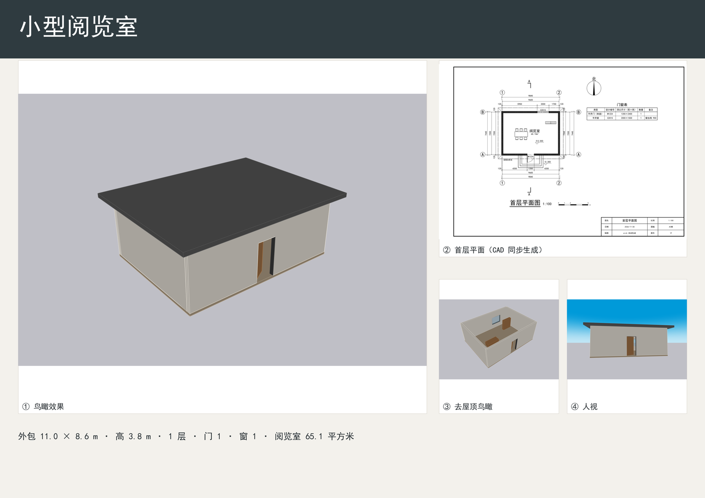

# Wish Architectural CAD

建筑方案的可编辑二维制图工具。一份毫米制 JSON 规格生成平面图、四向立面和指定剖面，每张图提供 DXF、PDF 和 PNG。改方案时修改同一份规格再出图。

An open-source, spec-driven 2D architectural drafting preview. A JSON building specification produces editable model-space DXF and matching PDF and PNG sheets.

## SU / CAD / PS 一体化

Windows 版可从同一份规格生成原生 SketchUp 模型、模型视图、CAD 平立剖和展板。选用 Photoshop 输出时，PSD 保留文字图层和智能对象。也可让 AutoCAD 只读打开生成的 DXF。请看 [桌面联动安装与使用](docs/windows-suite.md)。



## 快速开始

需要 Python 3.10+ 和可用的中文字体。以下以 PowerShell 为例，在仓库目录执行。

```powershell
python -m venv .venv
.\.venv\Scripts\python -m pip install .
.\.venv\Scripts\wish-cad check examples/reading-room.json
.\.venv\Scripts\wish-cad plan examples/reading-room.json --output build/reading-room
```

macOS 和 Linux 的虚拟环境命令位于 `.venv/bin/`。如果系统没有检测到黑体、微软雅黑、Noto Sans CJK 或思源黑体，先安装中文字体，或用 `WISH_CAD_FONT` 指定它的文件路径（TTF、OTF 或 TTC）。在其他电脑打开 DXF 时，也需要该文字样式所引用的字体。

输出目录须是新目录。默认使用 `build/<方案名>`，也可在 JSON 内指定 `out_dir` 或用 `--output` 覆盖。先看 `report.json`，再打开 PNG 检查标注、文字和出图范围。失败时保留已生成的图纸和错误明细。

## 规格怎么写

[小型阅览室](examples/reading-room.json) 是纯虚构示例，包含外墙、门窗、房间、家具、屋顶和剖切线。模型坐标与长度均为毫米。图纸比例通过 `drawing.scale` 指定分母，例如 `100` 对应 1:100。外墙按轮廓点的顺序编号，门窗位置沿对应的墙段从起点量。

核心支持轴网、尺寸、门窗表、标高、建筑外轮廓和基本家具图块。可以使用 JSON 的 `drawing.elevations: false` 跳过四向立面，显式指定的剖面仍会生成。

## 发布范围

当前是建筑方案出图预览版。可先看[样例平面](examples/reading-room-preview.png)。DXF 为毫米制 1:1 模型空间图，A 系列图框与标题栏绘制在 PDF 和 PNG 上。打印时使用 PDF 的实际大小。剖面和立面中的楼梯、室外台阶坡道、家具与材料引注需人工补充。图纸供方案推敲和后续深化，工程交付仍需按项目要求复核。

二维模式仅依赖 Python 库。Windows 桌面联动需要对应桌面软件。示例用基础颜色和家具体块。作为 Codex 技能使用时，把整个仓库置于可发现的技能目录，并先在可用的 Python 环境中完成上述安装。使用入口见 [SKILL.md](SKILL.md)。

开发验证：安装后运行 `python -m unittest discover -s tests -v`。本版已在 Windows / Python 3.12 试跑。

许可证为 [MIT](LICENSE)。
